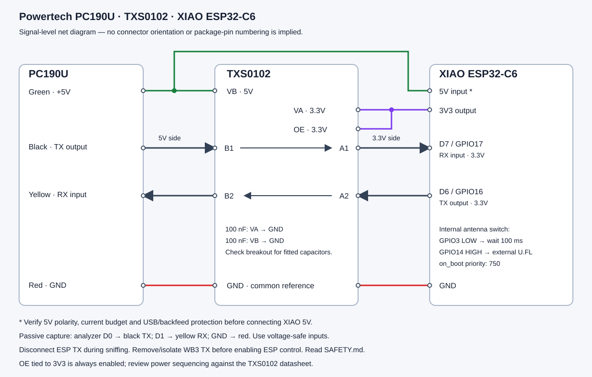
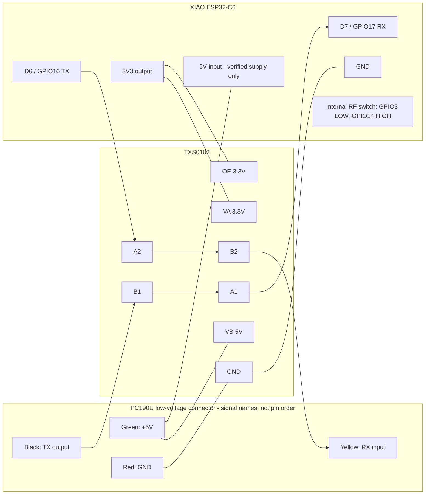

# Hardware

Read [SAFETY.md](SAFETY.md) first. Work only on the verified low-voltage
PC190U/WB3 interface with power disconnected. Colors below are the requested
replacement harness mapping; they are not a universal manufacturer pinout.

## Parts

| Qty | Part | Requirement |
|---|---|---|
| 1 | Powertech PC190U controller and existing gate | Operational safety inputs and limits |
| 1 | Original paired WB3 module | For initial passive identification/capture |
| 1 | Seeed Studio XIAO ESP32-C6 | ESP-IDF, 4 MB flash; D7 RX / D6 TX |
| 1 | TXS0102 breakout | Genuine suitable translator; accessible VA, VB, OE, A1/A2, B1/B2, GND |
| 2 | 100 nF ceramic bypass capacitors | VA-to-GND and VB-to-GND, close to IC; verify if already fitted |
| 1 | Appropriate 2.4 GHz U.FL antenna | Connect before selecting external antenna |
| As needed | Short insulated wires, connectors, enclosure, strain relief | Outdoor moisture protection; separation from mains and motor cables |
| 1 | Verified regulated 5 V supply path | PC190U rail only if measured suitable under Wi-Fi load; otherwise engineered separate supply |
| 1 | Multimeter | Check GND, polarity, voltage and rail stability |
| 1 | USB data cable | Programming; avoid connecting competing 5 V sources |
| 1 | FX2-compatible logic analyzer and sigrok/PulseView | Passive two-channel capture; check input voltage limits |
| As needed | High-impedance voltage-safe analyzer front end | Required if analyzer cannot tolerate the measured UART voltage |

## Exact net list

| PC190U cable | Function relative to PC190U | TXS0102 / XIAO connection |
|---|---|---|
| **Red** | **GND** | TXS0102 GND and XIAO GND |
| **Black** | **TX**, controller output | TXS0102 B1; A1 → XIAO **D7 / GPIO17 RX** |
| **Yellow** | **RX**, controller input | TXS0102 B2; A2 ← XIAO **D6 / GPIO16 TX** |
| **Green** | **+5V** supply | TXS0102 VB; XIAO 5V only after supply checks |

| TXS0102 pin | Net |
|---|---|
| VA / VCCA | XIAO 3V3, **3.3 V** |
| VB / VCCB | Verified PC190U green +5V, **5 V** |
| OE | XIAO 3V3, **3.3 V**, always enabled in this requested circuit |
| GND | Common ground: red PC190U GND and XIAO GND |
| A1 ↔ B1 | XIAO RX ← controller TX |
| A2 ↔ B2 | XIAO TX → controller RX |

No package-pin numbers or connector orientation are inferred. Read your
breakout's labels and board documentation; module layouts differ. Do not use an
older diagram with red=+5V or black=GND for this harness.

## Wiring diagram

Add 100 nF from VA to GND and from VB to GND unless the breakout already has
them. Keep translator wiring short. The RF GPIOs connect to the on-board antenna
switch, **not** to the PC190U connector.

## Electrical constraints

The [TI TXS0102 datasheet](https://www.ti.com/lit/ds/symlink/txs0102.pdf) specifies
an A-side supply up to 3.6 V, a B-side supply up to 5.5 V, and VA ≤ VB. OE is
referenced to VA; do not tie it to 5 V. This circuit is a level translator,
not galvanic isolation. Verify actual UART voltage rather than assuming every
controller revision uses identical levels.

The requested OE-to-3V3 connection leaves the translator enabled whenever that
rail is high. TI recommends holding OE low during power-up/down until both rails
are stable. If independent power rails or sequencing can violate this, implement
proper OE sequencing and review the circuit before use; a direct tie does not
provide that protection. Do not add arbitrary pull resistors or long cables to
TXS auto-direction signals without checking loading and edge behavior.

The PC190U rail's available current has not been measured here. Confirm operation
under Wi-Fi transmit peaks. When programming by USB, disconnect controller 5V from
XIAO 5V unless a verified power arrangement prevents backfeeding. With a separate
XIAO supply retain common GND and translation references, and review power-off
behavior. Never parallel unverified supply outputs.

For passive sniffing keep WB3 connected and ESP TX physically disconnected. With
OE permanently enabled, omitting `tx_pin` alone is not a guarantee that an attached
translator channel cannot load or bias another transmitter's line.

Pin mapping and RF control follow the [official Seeed XIAO ESP32-C6
documentation](https://wiki.seeedstudio.com/xiao_esp32c6_getting_started/).
