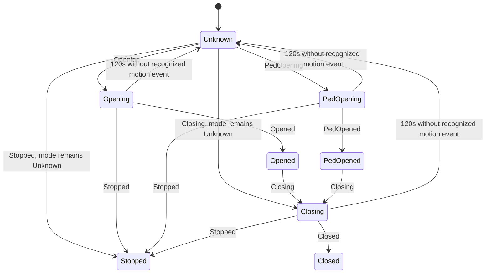

# State model and review of earlier problems

Two opening actions address one physical gate. Mode is metadata observed from
`Opening`/`Opened` or `PedOpening`/`PedOpened`; it is never selected merely because
a command was queued. Both covers receive identical physical feedback.

| Event | Observed mode | Both covers | Binary presentation |
|---|---|---|---|
| Boot / movement feedback expired | Unknown | Idle; physical position unknown | Not confirmed closed |
| `Closed` | Unknown (no active opening mode) | Idle | Closed |
| `Opening` | Full | Opening | Not closed; unmeasured |
| `Opened` | Full | Idle | Open; full-open event observed |
| `PedOpening` | Pedestrian | Opening | Not closed; unmeasured |
| `PedOpened` | Pedestrian | Idle | Open; pedestrian completion, not full travel |
| `Closing` | Retain observed mode, including Unknown | Closing | Not closed; unmeasured |
| `Stopped` | Retain observed mode, including Unknown | Idle | Partial/unknown, not full-open confirmation |

The diagram illustrates common paths, not an enforced controller transition
grammar. Every recognized event can restore state directly, including terminal
events after reboot and RF-initiated motion. Unknown states, ACKs, malformed lines
and incomplete fragments do not establish movement or refresh the event timestamp.

## Commands and STOP

Open/close requests use the selected tile's command, a private validated source,
an explicit software TX enable flag and a shared 750 ms rate limit. Queuing UART
bytes does not prove controller acceptance, and never changes observed state or
mode. There is no optimistic publication, command replay or automatic retry.

STOP is accepted only if the last recognized state is Opening, PedOpening or
Closing and its age is **less than 120 seconds**. It bypasses the ordinary command
rate limit so it can be sent immediately after motion feedback. One pending STOP
is permitted per unchanged motion state; a duplicate Opening/Closing event does
not clear that latch. A transition to another recognized state does. This prevents
two cover tiles from sending repeated STOPs for the same movement. A lost STOP is
not automatically retried; use the physical controller if necessary.

At 120 seconds without recognized feedback during movement, status/mode become
Unknown and STOP is blocked. This is an engineering timeout, **not a measured gate
travel time**. Review it for your installation. The timeout sends no command.
It cannot detect an electrically disconnected UART during quiet idle periods.
`Gate Observation Age` measures age of a recognized event, not an established
heartbeat or connection-health guarantee; even old data may be the latest valid
idle observation. No freshness claim is inferred from arbitrary UART bytes.

## Cover display limitations

ESPHome template cover state uses a float and an operation, without a dependable
per-entity unknown/unavailable representation for this binary example. Therefore:

- Only an observed `Closed` produces position 0.
- Only observed `Opened` produces position 1.
- Unknown, motion, pedestrian completion and stop use internal position **0.5**
  as a conservative partial/unknown marker. This is **not a 50% estimate**.
- `has_position: false` prevents percentage control; `assumed_state: true` keeps
  command choices available and signals the limitations of the presentation.
- Home Assistant/HomeKit may display all nonzero binary states as “open”. That
  means not confirmed closed, not necessarily fully open. During startup a client
  may briefly display its own default/cached state before the first publication.
  The textual `Gate Observed Status` is Unknown until feedback arrives.

No restoration of a previous cover state is requested; observed model state lives
only in RAM. For accurate unknown/unavailable handling, add independently verified
sensors and a carefully designed Home Assistant availability model. This example
does not claim a network-connected ESP32 can prove the gate's physical state.

## Changes from the earlier example

| Earlier problem | Current handling |
|---|---|
| Inactive cover reported closed while gate physically open | Both covers follow physical state; modes only choose open command |
| Command immediately changed mode even if rejected | Only parsed events establish mode/state |
| Closing/Stopped with unknown mode fell back to Full | Keep Unknown mode and publish the physical event to both covers |
| Closing/Stopped did not normalize the inactive entity | A single publication function updates both covers every time |
| Stopped forced full-open position | Use unmeasured intermediate marker, preserve Stopped diagnostic |
| UART debugger fragments treated as complete lines | Bounded reassembly through newline; discard oversize/corrupt lines |
| STOP available while idle/unknown | Recent movement predicate plus duplicate-STOP latch |
| No motion timeout | Timeout to Unknown; no fabricated terminal state |
| ACK/status polling semantics assumed | No ACK state parser or polling until verified |
| Async boot delay claimed to finish before Wi-Fi | Synchronous wait at priority 750, using initialized GPIO outputs |

Publishing both synchronized entities through HomeKit can generate two activity
notifications for one movement. Configure notifications on one tile, or export
only one cover. HomeKit notification behavior requires on-device acceptance.
